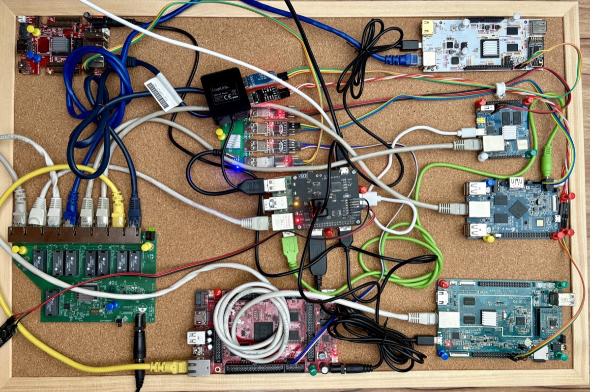
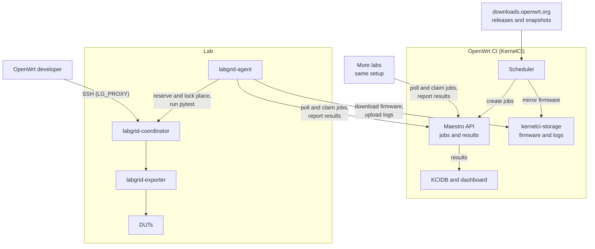
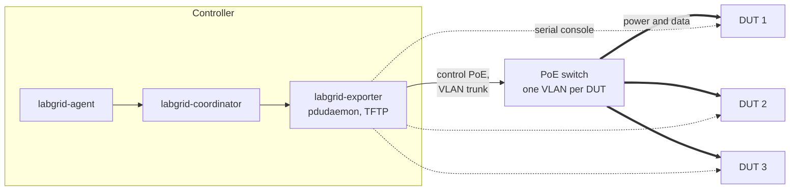

# OpenWrt Testing

> With great many support devices comes great many tests

OpenWrt Testing is a framework to run tests on OpenWrt devices, emulated or
real. Using [`labgrid`](https://labgrid.readthedocs.io/en/latest/) to control
the devices, the framework offers a simple way to write tests and run them on
different hardware.

## Testing

This section provides information on how to run tests using OpenWrt Testing,
either on real or emulated devices. If you want to deploy real devices for
testing, please see the [Lab Setup](#lab-setup) section.

### Requirements

There are multiple ways to run tests, on real or emulated devices.

- An OpenWrt firmware image
- Python and [`uv`](https://docs.astral.sh/uv/)
- QEMU (for emulated devices)

### Setup

For maximum convenience, clone the repository inside the `openwrt.git`
repository as `tests/`:

```shell
cd /path/to/openwrt.git/
git clone https://github.com/aparcar/openwrt-tests.git tests/
```

Install required packages to use Labgrid and QEMU:

```shell
curl -LsSf https://astral.sh/uv/install.sh | sh

sudo apt-get update
sudo apt-get -y install \
    qemu-system-mips \
    qemu-system-x86 \
    qemu-system-aarch64 \
    make
```

Verify the installation by running the tests:

```shell
make tests/setup V=s
```

## Running tests

You can run tests via the Makefile or directly using `pytest`.

### Using the Makefile

You can start runtime and shell tests via the Makefile.

```shell
cd /path/to/openwrt.git
make tests/x86-64 V=s
```

### Standalone usage

If you don't plan to clone this repository inside the `openwrt.git` repository,
you can still run the tests. Use this command to run tests on `malta/be` image:

```shell
uv run pytest tests/ \
    --lg-env targets/qemu_malta-be.yaml \
    --lg-log \
    --log-cli-level=CONSOLE \
    --firmware ../../openwrt/bin/targets/malta/be/openwrt-malta-be-vmlinux-initramfs.elf
```

`--log-cli-level=CONSOLE` shows the serial console live. `--lg-log` writes it
to files. `--results-json results.json` saves every test's status and
measured values (see below).

## Writing tests

The framework uses `pytest` to execute commands and evaluate the output. Test
cases use the two _fixture_ `ssh_command` or `shell_command`. The object offers
the function `run(cmd)` and returns _stdout_, _stderr_ (SSH only) and the exit
code.

The example below runs `uname -a` and checks that the device is running
_GNU/Linux_

```python
def test_uname(shell_command):
    assert "GNU/Linux" in shell_command.run("uname -a")[0][0]
```

More conventions:
- **Device-specific tests:** mark them with `@pytest.mark.lg_feature("wan_port")`
  (or `wifi-2g`, `wifi-5g`, `wifi-6g`, `rootfs`, …). They're skipped on targets
  that don't list the feature under `features:` in `targets/<device>.yaml`.
- **Measurements:** store them in the `results_bag` fixture, e.g.
  `results_bag["used_memory"] = …`. `--results-json PATH` writes all of them,
  with each test's status, to one JSON file.
- **Tests that need the [labgrid-probe](contrib/labgrid-probe/README.md):**
  take the `probe` fixture. It reserves and locks the lab's probe for the test
  module and skips in labs without one (`tests/test_probe_lan.py`).

## Remote Access

With *labgrid*, you can remotely access devices. Key capabilities include
**power control**, **console**, and **SSH access**.

To enable remote access, you need SSH access with forwarding enabled on the lab
host, which runs the lab's coordinator and exports its devices. Developers log
in as the shared `labgrid-dev` account; the lab's admin adds your key. For
example, to
reach the device `openwrt-one` located in the lab `labgrid-aparcar`, you need
access to the `labgrid-aparcar` host:

```shell
labgrid-aparcar -> openwrt-one
```

You can request access to existing labs or contribute your own. To do this,
submit a pull request modifying the `labnet.yaml` file. To add a device, see
[docs/adding-a-device.md](docs/adding-a-device.md). If you have multiple
devices of the same model, see [docs/sharing-target-files.md](docs/sharing-target-files.md)
for how to avoid duplicate target files. For repository-specific metadata under
`openwrt:`, see [docs/openwrt-target-attributes.md](docs/openwrt-target-attributes.md)

To access a remote device, configure the following environment variables.
Notably, `LG_PROXY` sets the proxy host (always the lab name):

```shell
export LG_IMAGE=~/firmware/openwrt-ath79-generic-tplink_tl-wdr3600-v1-initramfs-kernel.bin # Firmware to boot
export LG_PLACE=aparcar-tplink_tl-wdr3600-v1 # Target device, formatted as <lab>-<device>
export LG_PROXY=labgrid-aparcar # Proxy to use, typically the lab name
export LG_ENV=targets/tplink_tl-wdr3600-v1.yaml # Environment definition
```

**Notes:**
- Always set `LG_ENV`. `conftest.py` is meant to resolve it from `LG_PLACE`
  via `labnet.yaml`, but that lookup doesn't work with the current
  `labnet.yaml` layout. See
  [docs/sharing-target-files.md](docs/sharing-target-files.md) for target files
  shared by several devices.
- `LG_PLACE` may be the short `<lab>-<device>`. labgrid matches it against the
  full place name `labgrid-<lab>-<device>`.
- On macOS, `export TMPDIR=/tmp`. labgrid's SSH control sockets otherwise
  exceed the socket path length limit under the long default `$TMPDIR`.

To avoid interference from CI or other developers, lock the device before use:

```shell
uv run labgrid-client lock
```

Once locked, you can power-cycle the device and access its console:

```shell
uv run labgrid-client power cycle
uv run labgrid-client console
```

To bring the device into a specific state—such as booting your firmware defined
by `LG_IMAGE`—use a state definition:

```shell
uv run labgrid-client --state shell console
```

You can also run local tests directly on the remote device:

```shell
uv run pytest tests/ --log-cli-level=CONSOLE --results-json results.json
```

Lastly, unlock your device when you're done:

```shell
uv run labgrid-client unlock
```

## Lab Setup



*[wigyorilab](docs/labs/wigyorilab.md): a Raspberry Pi 4 controlling six
single-board computers.*

Setting up a new lab involves several steps and is a fun and curious process,
however some precise and forward thinking is required to ensure a successful
setup. This section describes a low-cost setup usable for network communities
and individuals. Larger setups will be added in the future.

### Concept

Labs are independent: each runs its own labgrid coordinator and exporter for
its devices. Automated testing goes through OpenWrt CI, a self-hosted
[KernelCI](https://kernelci.org/) instance. It picks up new releases and
snapshots, mirrors the firmware and creates test jobs. Each lab runs a
[`labgrid-agent`](https://github.com/aparcar/kernelci-labgrid) that polls for
jobs of its devices, runs these tests against them and reports the results,
which end up in KCIDB and the KernelCI dashboard.



Labs only need outbound HTTPS to OpenWrt CI. The agent checks the health of
each device with a known-good image and only takes jobs for healthy devices.
If several labs have the same device, the first one to claim a job runs it.
Developers can still lock a device and use it directly, see
[Remote Access](#remote-access); the agent skips places that are locked or
tagged `maintenance=<reason>`.

### Requirements

* Controller (e.g. **Raspberry Pi 5**)
* PoE switch (e.g. **Linksys LGS328MPC v2**)
* PoE splitter for each DUT (12 V, 5 V, etc.)
* USB-to-serial adapter for each DUT
* Devices-Under-Test (DUTs)
* Some cables
* An uplink to the internet, e.g. a guest Wi-Fi
* Optional: a [labgrid-probe](contrib/labgrid-probe/README.md) (an OpenWrt
  device such as a GL.iNet GL-MT2500) for LAN/WAN tests (DHCP, DNS, SLAAC,
  throughput through the DUT)

### Setup

For a minimal setup, a single device runs the coordinator, exporter and agent,
from now on called controller. The controller is connected to a PoE switch,
which powers the DUTs and puts each one in its own VLAN. The exporter switches
PoE ports via `pdudaemon` to power cycle a DUT, serves firmware via TFTP and
reaches each DUT's console via a USB-to-serial adapter.

**VLANs:** each DUT has a LAN VLAN, and a WAN VLAN if its WAN port is cabled.
- **LAN VLAN:** the controller has static addresses there (`192.168.<VLAN>.1`
  for TFTP). U-Boot loads firmware with static addresses (`tftpboot`, never
  `dhcp`), and the controller serves **no DHCP**, so the booted DUT is the
  only DHCP server on its LAN.
- **WAN VLAN:** the controller is the DUT's upstream (IP forwarding). It's
  declared per place as a `wan` interface in `exporter.yaml`; see
  [docs/adding-a-device.md](docs/adding-a-device.md) and
  [docs/labs/aparcar.md](docs/labs/aparcar.md).

> [!NOTE]
> Larger setups may run multiple exporters, each connected to a separate PoE
> switch.



### Controller

The controller is set up via Ansible, see [ansible/README.md](ansible/README.md):
- **`ansible/lab.yml` (role `labgrid_lab`):** installs `labgrid` (the same
  pinned version the tests use), `pdudaemon`, a TFTP-only `dnsmasq`, the DUT
  VLANs, the per-lab exporter configuration from
  `ansible/files/exporter/<lab>/`, and the shared developer account
  `labgrid-dev`.
- **Role `labgrid_agent`** (also in this repository): sets up the
  [`labgrid-agent`](https://github.com/aparcar/kernelci-labgrid). OpenWrt CI's
  Ansible applies it, because it holds the lab's credentials. The agent runs
  as its own `labgrid-agent` account, and developers can't read its
  credentials.
