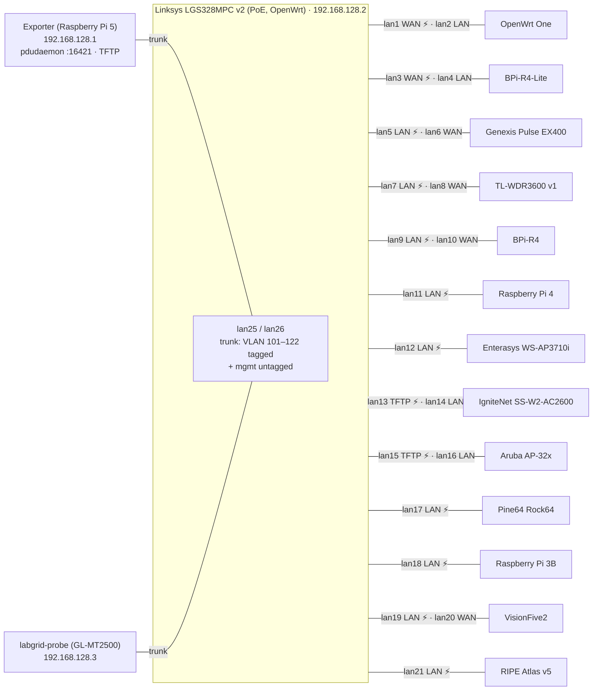
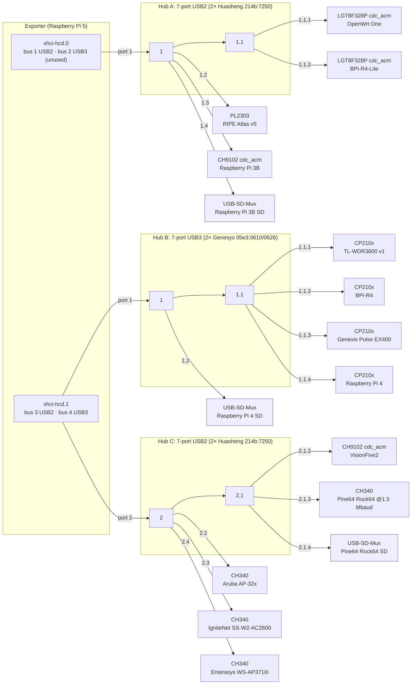

# Devices in aparcars Testlab

## Setup

### Coordinator/Exporter

- **Model:** Raspberry Pi 5
- **IP:** `192.168.128.1`
- **Power control:** `pdudaemon` runs on the exporter (`localhost:16421`) and
  toggles PoE on the switch below via its `ubus` driver; each device's
  `PDUDaemonPort.index` is the switch port that powers it.

### Switch (PDU)

- **Model:** Linksys LGS328MPC v2 (PoE, running OpenWrt)
- **IP:** `192.168.128.2`

### labgrid-probe

- **Model:** GL.iNet GL-MT2500 (`contrib/labgrid-probe`)
- **IP:** `192.168.128.3`
- **labgrid place:** `labgrid-aparcar-probe` (tag `role: probe`). Tests
  reserve and lock it for the test modules that use it.
- Sits on a trunk port with every DUT VLAN tagged. Per DUT it creates one
  network namespace on the LAN VLAN (DHCP client, iperf3 client) and one on
  the WAN VLAN (iperf3 server, DHCP for the DUT's WAN), so
  `tests/test_probe_lan.py` can test DHCP, DNS, SLAAC and LAN→WAN throughput
  through the DUT. Controlled as the `labgrid-probe` ubus object over HTTP;
  see `contrib/labgrid-probe/README.md`.

## Network

Every DUT gets two switch ports, each untagged in its own VLAN:

- **Switch ports:** port `lanN` is the untagged member of VLAN `100+N`.
- **Trunks:**
  - `lan25` and `lan26` carry all DUT VLANs (101–122) tagged, plus the
    management network (VLAN 1) untagged. That's where the exporter and the
    labgrid-probe are connected.
  - `lan27`/`lan28` are management only.
- **LAN VLAN** (the DUT's LAN port):
  - The exporter has `192.168.<VLAN>.1/24` for TFTP and `192.168.1.<VLAN>/24`
    to reach the DUT, which keeps its default `192.168.1.1`.
  - U-Boot gets static addresses: `serverip` is `192.168.<VLAN>.1` and
    `ipaddr` is `.2`, set by the strategy from the `tftp://` URL. It never
    needs DHCP.
  - Once booted, the DUT is the only DHCP server on this segment: the
    exporter's dnsmasq serves TFTP only, no DHCP.
- **WAN VLAN** (the DUT's WAN port, if cabled): the exporter is the upstream
  (`192.168.<VLAN>.1`, IP forwarding). The DUT's WAN lease comes from the
  labgrid-probe while a test has the WAN side up (`wan_up`; range
  `.100`–`.200`, router `.1`); the exporter serves no DHCP. It's
  declared per place as a `wan` resource in `exporter.yaml`:

  ```yaml
    wan:
      cls: NetworkInterface
      ifname: vlan101
  ```

  Tests read it as the place's `RemoteNetworkInterface` named `wan`.

## Wiring

### Network and power

Switch port `lanN` is VLAN `100+N`. ⚡ marks the PoE port that pdudaemon
toggles (`PDUDaemonPort.index`). The IgniteNet and the Aruba fetch firmware
over their second port (VLAN 113 and 115).



### USB (serial consoles and SD-Muxes)

Three 7-port hubs. Each one is two cascaded 4-port hub chips, with the inner
chip on port 1. The labels are the `ID_PATH` port numbers (from `lsusb -tv`).
Free ports: hub A `1.1.3`, `1.1.4`; hub B `1.3`, `1.4`; hub C `2.1.1`.



The USB-SD-Mux shows up as a `0424:2640` hub with a `0424:4041` card reader on
its port 1, which is the `USBSDMuxDevice` `ID_PATH` (e.g. `…:1.4.1`).

## Devices

Derived from `ansible/files/exporter/labgrid-aparcar/exporter.yaml`. Each row is
a labgrid place named `labgrid-aparcar-<device>`.

| Device                 | PoE port | LAN VLAN | WAN VLAN | Serial `ID_PATH`                      | Firmware delivery              |
| ---------------------- | -------- | -------- | -------- | ------------------------------------- | ------------------------------ |
| OpenWrt One            | 1        | 102      | 101      | `platform-xhci-hcd.0-usb-0:1.1.1:1.0` | TFTP via `192.168.102.1`       |
| BananaPi BPi-R4-Lite   | 3        | 104      | 103      | `platform-xhci-hcd.0-usb-0:1.1.2:1.0` | TFTP via `192.168.104.1`       |
| Genexis Pulse EX400    | 5        | 105      | 106      | `platform-xhci-hcd.1-usb-0:1.1.3:1.0` | TFTP via `192.168.105.1`       |
| TP-Link TL-WDR3600 v1  | 7        | 107      | 108      | `platform-xhci-hcd.1-usb-0:1.1.1:1.0` | TFTP via `192.168.107.1`       |
| BananaPi BPi-R4        | 9        | 109      | 110      | `platform-xhci-hcd.1-usb-0:1.1.2:1.0` | TFTP via `192.168.109.1`       |
| Raspberry Pi 4         | 11       | 111      | –        | `platform-xhci-hcd.1-usb-0:1.1.4:1.0` | SD-Mux (`USBSDMuxDevice`)      |
| Enterasys WS-AP3710i   | 12       | 112      | –        | `platform-xhci-hcd.1-usb-0:2.4:1.0`   | TFTP via `192.168.112.1`       |
| IgniteNet SS-W2-AC2600 | 13       | 114      | –        | `platform-xhci-hcd.1-usb-0:2.3:1.0`   | TFTP via `192.168.113.1`       |
| Aruba AP-32x           | 15       | 116      | –        | `platform-xhci-hcd.1-usb-0:2.2:1.0`   | TFTP via `192.168.115.1`       |
| Pine64 Rock64          | 17       | 117      | –        | `platform-xhci-hcd.1-usb-0:2.1.3:1.0` | SD-Mux (`USBSDMuxDevice`)      |
| Raspberry Pi 3B        | 18       | 118      | –        | `platform-xhci-hcd.0-usb-0:1.3:1.0`   | SD-Mux (`USBSDMuxDevice`)      |
| StarFive VisionFive2   | 19       | 119      | 120      | `platform-xhci-hcd.1-usb-0:2.1.2:1.0` | TFTP via `192.168.119.1`       |
| RIPE Atlas v5          | 21       | 121      | –        | `platform-xhci-hcd.0-usb-0:1.2:1.0`   | TFTP via `192.168.121.1`       |

Notes:

- **Firmware delivery:**
  - TFTP devices are flashed from the exporter's `/srv/tftp/<device>/`. Their
    `TFTPProvider.external` is a `tftp://192.168.<VLAN>.1/<device>/` URL.
  - The IgniteNet and the Aruba fetch over their second port, so their TFTP
    VLAN (113, 115) differs from their LAN VLAN.
  - The Raspberry Pis and the Pine64 Rock64 have no TFTP provider: they are
    imaged by switching their SD card to the host via a `USBSDMuxDevice`.
- **WAN VLAN:** "–" means the board has no WAN port, or it isn't cabled. The
  WAN VLANs were identified from the WAN MAC (LAN MAC ±1) in the exporter's
  DHCP leases. The VisionFive2 is wired to switch port `lan20`.
- **Serial:** the Aruba AP-32x and Pine64 Rock64 additionally match
  `@port_number: 0`. The Pine64 Rock64 console runs at 1500000 baud, all
  others at the default 115200.
- **LAN access:** the `NetworkService` reaches each device at
  `192.168.1.1%vlan<LAN VLAN>` as `root`.
- The devices the lab offers (its places' `device=` tags) come from the
  `devices:` list for `labgrid-aparcar` in `labnet.yaml`, not from this file.
