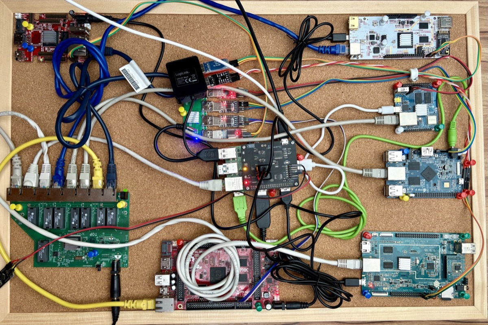

# Devices in wigyorilab

## Setup

### Coordinator/Exporter

- **Model:** Raspberry Pi 4
- **Network:** uplink in the untagged VLAN, one VLAN per DUT (`vlan101` to
  `vlan106`)
- **Serial consoles:** two 4-port USB hubs with various CP2102/PL2303
  adapters; the second hub hangs off port 7 of the first
- **Power control:**
  - UUGear 4-port switchable USB3 hub, used via labgrid's `USBPowerPort`
  - ClusterHAT with 4 switchable ports, used via `pdudaemon`
    (`localhost:16421`, PDU `clusterhat`), which runs
    `clusterctrl on|off p<index>`

### Switch

- **Model:** TP-Link SG108E (managed)

## Devices

Derived from `ansible/files/exporter/labgrid-wigyori/exporter.yaml`. Each row is
a labgrid place named `labgrid-wigyori-<device>`.

| Device                 | Power         | VLAN | Serial `ID_PATH` suffix | TFTP server     |
| ---------------------- | ------------- | ---- | ----------------------- | --------------- |
| Olimex A10 Lime        | UUGear 1      | 101  | `usb-0:1.3.4:1.0`       | `192.168.101.1` |
| Olimex A20 Micro       | UUGear 2      | 102  | `usb-0:1.3.3:1.0`       | `192.168.102.1` |
| Orange Pi 2            | UUGear 3      | 103  | `usb-0:1.3.2:1.0`       | `192.168.103.1` |
| Orange Pi Zero2        | UUGear 4      | 104  | `usb-0:1.3.1:1.0`       | `192.168.104.1` |
| LinkSprite pcDuino     | ClusterHAT 1  | 105  | `usb-0:1.3.7.3:1.0`     | `192.168.105.1` |
| Pine64 Plus            | ClusterHAT 2  | 106  | `usb-0:1.3.7.4:1.0`     | `192.168.106.1` |

Notes:

- **Serial:** all `ID_PATH`s start with
  `platform-fd500000.pcie-pci-0000:01:00.0-`. The pcDuino and Pine64 Plus
  additionally match `@port_number: 0`. All consoles run at 115200 baud.
- **Power:** the UUGear hub is matched by
  `platform-fd500000.pcie-pci-0000:01:00.0-usb-0:2:1.0`; the table lists its
  port (`USBPowerPort.index`) or the ClusterHAT port (`PDUDaemonPort.index`).
- **Firmware delivery:** there is no SD-Mux, so the boards boot U-Boot from an
  SD card with the latest snapshot U-Boot, then load the firmware over TFTP
  from the exporter's `/tftpboot/<device>/`, reached at the address in the
  table (`TFTPProvider.external`).
- **VLAN:** the `NetworkService` reaches each device at
  `192.168.1.1%vlan<VLAN>` as `root`.
- The devices the lab offers (its places' `device=` tags) come from the
  `devices:` list for `labgrid-wigyori` in `labnet.yaml`, not from this file.
