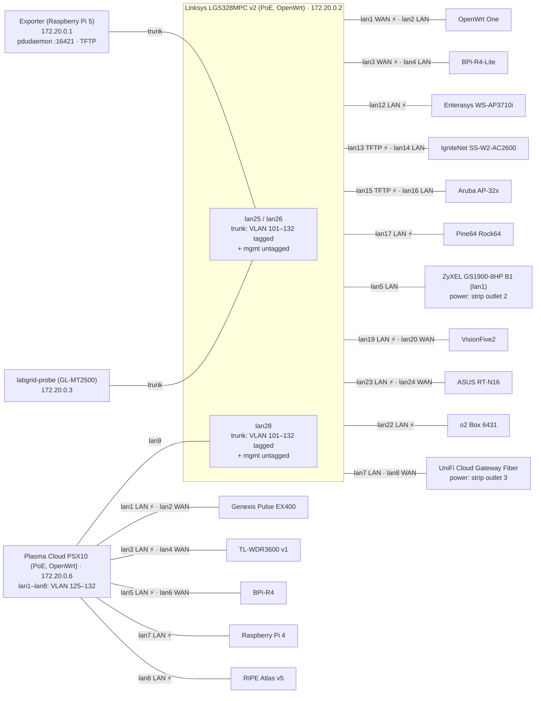
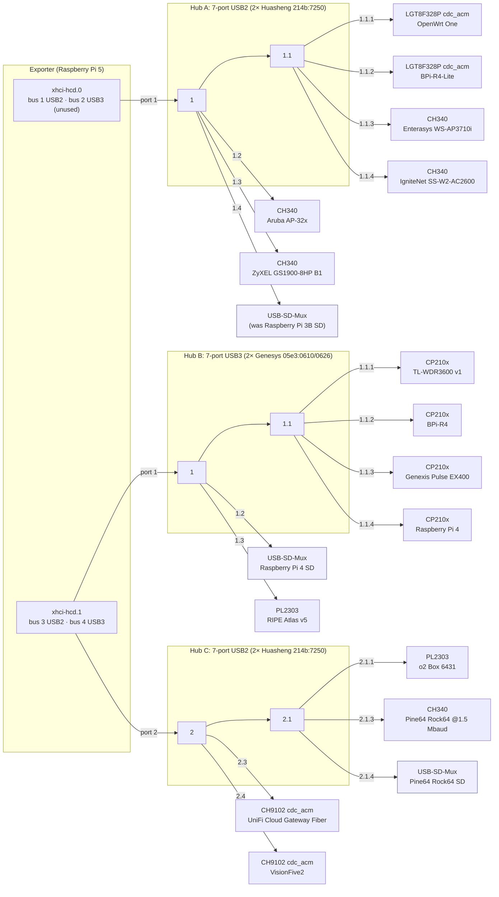

# Devices in aparcars Testlab

## Setup

### Coordinator/Exporter

- **Model:** Raspberry Pi 5
- **IP:** `172.20.0.1`
- **Power control:** `pdudaemon` runs on the exporter (`localhost:16421`) and
  toggles PoE on the switches below via its `ubus` driver; each device's
  `PDUDaemonPort.pdu` is the switch (`labgrid-switch-1` or `labgrid-switch-2`)
  and `.index` the port that powers it
  (`labs/labgrid-aparcar/pdudaemon.conf`). The names resolve
  through the exporter's `/etc/hosts` (`labgrid_hosts` in
  `ansible/host_vars/labgrid-aparcar.yml`).

### Management network

`172.20.0.0/24`, untagged on the trunks. It isn't `192.168.128.0/24` (as in
other labs) because DUT VLAN 128 needs `192.168.128.0/24` on the exporter.

| Address      | Device                                  |
| ------------ | --------------------------------------- |
| `172.20.0.1` | Exporter                                |
| `172.20.0.2` | `labgrid-switch-1` (Linksys LGS328MPC)  |
| `172.20.0.3` | labgrid-probe                           |
| `172.20.0.4` | Wi-Fi probe                             |
| `172.20.0.5` | Wi-Fi probe 2                           |
| `172.20.0.6` | `labgrid-switch-2` (Plasma Cloud PSX10) |

### Switch 1 (PDU)

- **Model:** Linksys LGS328MPC v2 (PoE, running OpenWrt)
- **IP:** `172.20.0.2`
- **DUT ports:** `lan1`–`lan24`, VLAN 101–124

### Switch 2 (PDU)

- **Model:** Plasma Cloud PSX10 (PoE, running OpenWrt)
- **IP:** `172.20.0.6`
- **DUT ports:** `lan1`–`lan8`, VLAN 125–132. `lan9`/`lan10` are SFP+.

Both switches are set up with `contrib/labgrid-switch/install-switch.sh`
(VLANs, trunks, management address, hostname):

```shell
sh contrib/labgrid-switch/install-switch.sh --name labgrid-switch-1 \
    --address 172.20.0.2/24 --gateway 172.20.0.1 \
    --first-vlan 101 --ports 24 --transit 125-132 \
    --trunk lan25 --trunk lan26 --trunk lan28 --mgmt lan27 \
    root@172.20.0.2 -J labgrid-aparcar

sh contrib/labgrid-switch/install-switch.sh --name labgrid-switch-2 \
    --address 172.20.0.6/24 --gateway 172.20.0.1 \
    --first-vlan 125 --ports 8 --trunk lan9 \
    root@172.20.0.6 -J labgrid-aparcar
```

It writes the config without applying it; `/etc/init.d/network restart` on
the switch does.

### Power strip (PDU)

- **Model:** Shelly Power Strip 4 Gen4 (`ShellyPStripG4-D885ACEBBCB0`), for
  devices that can't be powered over PoE
- **pdudaemon name:** `labgrid-strip-1`, driver `shelly_gen2`: JSON-RPC over
  HTTP to the strip at `192.168.8.214` (Wi-Fi). The driver connects to the
  PDU's name, so `labgrid_hosts` in the host's `ansible/host_vars` maps
  `labgrid-strip-1` to that address. Bluetooth LE (`shelly_ble`) dropped
  every connection during service discovery (HCI reason 0x3e).
- **Outlets:** `PDUDaemonPort.index` 0–3, so index 3 is the fourth socket.
  Index 3 powers the UniFi Cloud Gateway Fiber (`ubnt_ucgfiber`, bring-up
  only: no published image yet, so its healthcheck fails and CI schedules
  nothing on it). Index 2 powers the ZyXEL GS1900-8HP B1
  (`zyxel_gs1900-8hp-b1`, in maintenance: kselftest loops, see below).
- Authentication must stay disabled on the strip (`shelly_gen2` doesn't
  support it), and it needs a fixed address (DHCP reservation).

### labgrid-probe

- **Model:** GL.iNet GL-MT2500 (`contrib/labgrid-probe`)
- **IP:** `172.20.0.3`
- **labgrid place:** `labgrid-aparcar-probe` (tag `role: probe`). Tests
  reserve and lock it for the test modules that use it.
- Sits on a trunk port with every DUT VLAN tagged. Per DUT it creates one
  network namespace on the LAN VLAN (DHCP client, iperf3 client) and one on
  the WAN VLAN (iperf3 server, DHCP for the DUT's WAN), so
  `tests/test_probe_lan.py` can test DHCP, DNS, SLAAC and LAN→WAN throughput
  through the DUT. Controlled as the `labgrid-probe` ubus object over HTTP;
  see `contrib/labgrid-probe/README.md`.

## Network

Every DUT gets two switch ports, each untagged in its own VLAN:

- **Switch ports:** on switch 1, port `lanN` is the untagged member of VLAN
  `100+N`; on switch 2, of VLAN `124+N`.
- **Trunks:**
  - Switch 1 `lan25` and `lan26` carry all DUT VLANs (101–132) tagged, plus
    the management network (VLAN 1) untagged. That's where the exporter and
    the labgrid-probe are connected.
  - Switch 1 `lan28` is the uplink of switch 2 (its `lan9`): the DUT VLANs
    tagged, management untagged.
  - Switch 1 `lan27` is management only.
- **LAN VLAN** (the DUT's LAN port):
  - The exporter has `192.168.<VLAN>.1/24` for TFTP and `192.168.1.<VLAN>/24`
    to reach the DUT, which keeps its default `192.168.1.1`.
  - U-Boot gets static addresses: `serverip` is `192.168.<VLAN>.1` and
    `ipaddr` is `.2`, set by the strategy from the `tftp://` URL. It never
    needs DHCP.
  - Once booted, the DUT is the only DHCP server on this segment: the
    exporter's dnsmasq serves TFTP only, no DHCP.
- **WAN VLAN** (the DUT's WAN port, if cabled): the exporter is the upstream
  (`192.168.<VLAN>.1`, IP forwarding). The DUT's WAN lease comes from the
  labgrid-probe while a test has the WAN side up (`wan_up`; range
  `.100`–`.200`, router `.1`); the exporter serves no DHCP. It's
  declared per place as a `wan` resource in `exporter.yaml`:

  ```yaml
  wan:
    cls: NetworkInterface
    ifname: vlan101
  ```

  Tests read it as the place's `RemoteNetworkInterface` named `wan`.

## Wiring

### Network and power

Switch 1 port `lanN` is VLAN `100+N`, switch 2 port `lanN` is VLAN `124+N`.
⚡ marks the PoE port that pdudaemon toggles (`PDUDaemonPort.index`, on the
switch named in `PDUDaemonPort.pdu`). The IgniteNet and the Aruba fetch
firmware over their second port (VLAN 113 and 115).



### USB (serial consoles and SD-Muxes)

Three 7-port hubs. Each one is two cascaded 4-port hub chips, with the inner
chip on port 1. The labels are the `ID_PATH` port numbers (from `lsusb -tv`).
Free ports: hub B `1.4`; hub C `2.1.2`, `2.2`.



The USB-SD-Mux shows up as a `0424:2640` hub with a `0424:4041` card reader on
its port 1, which is the `USBSDMuxDevice` `ID_PATH` (e.g. `…:1.4.1`).

## Devices

Derived from `labs/labgrid-aparcar/exporter.yaml`. Each row is
a labgrid place named `labgrid-aparcar-<device>`.

### Switch 1 (`labgrid-switch-1`)

| Device                 | PoE port | LAN VLAN | WAN VLAN | Serial `ID_PATH`                      | Firmware delivery                  |
| ---------------------- | -------- | -------- | -------- | ------------------------------------- | ---------------------------------- |
| OpenWrt One            | 1        | 102      | 101      | `platform-xhci-hcd.0-usb-0:1.1.1:1.0` | TFTP via `192.168.102.1`           |
| BananaPi BPi-R4-Lite   | 3        | 104      | 103      | `platform-xhci-hcd.0-usb-0:1.1.2:1.0` | TFTP via `192.168.104.1`           |
| ZyXEL GS1900-8HP B1    | strip 2  | 105      | –        | `platform-xhci-hcd.0-usb-0:1.3:1.0`   | TFTP via `192.168.105.1` (maintenance) |
| UniFi Cloud Gateway Fiber | strip 3 | 107     | 108      | `platform-xhci-hcd.1-usb-0:2.3:1.0`   | TFTP via `192.168.107.1` (bring-up only) |
| Enterasys WS-AP3710i   | 12       | 112      | –        | `platform-xhci-hcd.0-usb-0:1.1.3:1.0` | TFTP via `192.168.112.1`           |
| IgniteNet SS-W2-AC2600 | 13       | 114      | –        | `platform-xhci-hcd.0-usb-0:1.1.4:1.0` | TFTP via `192.168.113.1`           |
| Aruba AP-32x           | 15       | 116      | –        | `platform-xhci-hcd.0-usb-0:1.2:1.0`   | TFTP via `192.168.115.1`           |
| Pine64 Rock64          | 17       | 117      | –        | `platform-xhci-hcd.1-usb-0:2.1.3:1.0` | SD-Mux (`USBSDMuxDevice`)          |
| StarFive VisionFive2   | 19       | 119      | 120      | `platform-xhci-hcd.1-usb-0:2.4:1.0`   | TFTP via `192.168.119.1`           |
| o2 Box 6431            | 22       | 122      | –        | `platform-xhci-hcd.1-usb-0:2.1.1:1.0` | U-Boot flashes via `192.168.122.1` |
| ASUS RT-N16            | 23       | 123      | 124      | not connected                         | CFE flashes via `192.168.123.1`    |

Free ports: `lan6`, `lan9`–`lan11`, `lan18`, `lan21`.

### Switch 2 (`labgrid-switch-2`)

| Device                | PoE port | LAN VLAN | WAN VLAN | Serial `ID_PATH`                      | Firmware delivery         |
| --------------------- | -------- | -------- | -------- | ------------------------------------- | ------------------------- |
| Genexis Pulse EX400   | 1        | 125      | 126      | `platform-xhci-hcd.1-usb-0:1.1.3:1.0` | TFTP via `192.168.125.1`  |
| TP-Link TL-WDR3600 v1 | 3        | 127      | 128      | `platform-xhci-hcd.1-usb-0:1.1.1:1.0` | TFTP via `192.168.127.1`  |
| BananaPi BPi-R4       | 5        | 129      | 130      | `platform-xhci-hcd.1-usb-0:1.1.2:1.0` | TFTP via `192.168.129.1`  |
| Raspberry Pi 4        | 7        | 131      | –        | `platform-xhci-hcd.1-usb-0:1.1.4:1.0` | SD-Mux (`USBSDMuxDevice`) |
| RIPE Atlas v5         | 8        | 132      | –        | `platform-xhci-hcd.1-usb-0:1.3:1.0`   | TFTP via `192.168.132.1`  |

No free ports.

Notes:

- **Firmware delivery:**
  - TFTP devices are flashed from the exporter's `/srv/tftp/<device>/`. Their
    `TFTPProvider.external` is a `tftp://192.168.<VLAN>.1/<device>/` URL.
  - The IgniteNet and the Aruba fetch over their second port, so their TFTP
    VLAN (113, 115) differs from their LAN VLAN.
  - The Raspberry Pis and the Pine64 Rock64 have no TFTP provider: they are
    imaged by switching their SD card to the host via a `USBSDMuxDevice`.
  - The ASUS RT-N16 has CFE instead of U-Boot and no netbootable image:
    `CFETFTPStrategy` interrupts CFE, gives it `192.168.123.2` and writes the
    TRX to flash over TFTP on every run (several minutes).
  - The o2 Box 6431 can't boot an initramfs: U-Boot loads the sysupgrade
    image over TFTP, writes it to the firmware partition (`0xb0080000`) and
    boots it from flash on every run (`flash_commands` of
    `UBootTFTPStrategy` in its target file).
- **WAN VLAN:** "–" means the board has no WAN port, or it isn't cabled. The
  WAN VLANs were identified from the WAN MAC (LAN MAC ±1) in the exporter's
  DHCP leases. The VisionFive2 is wired to switch port `lan20`.
- **Serial:** the Enterasys, IgniteNet, Aruba AP-32x, Pine64 Rock64, o2 Box
  6431, RIPE Atlas v5 and GS1900-8HP additionally match `@port_number: 0`.
- **GS1900-8HP B1:** loop cables lan5↔lan6 and lan7↔lan8 for the kernel's DSA
  selftests. Its stock U-Boot enables all ports with `rtk network on`, so
  the target file stops RX/TX on lan5–8 there (`mw.l` on `MAC_PORT_CTRL`,
  not saved) before TFTP. It stays in `maintenance:`: an
  official image would bridge the loops; only self-built kselftest images
  keep lan5–8 out of the bridge. The Pine64
  Rock64 console runs at 1500000 baud, all others at the default 115200. The
  ASUS RT-N16's console is not connected at the moment.
- **LAN access:** the `NetworkService` reaches each device at
  `192.168.1.1%vlan<LAN VLAN>` as `root`.
- The devices the lab offers (its places' `device=` tags) come from the
  `devices:` list in `labs/labgrid-aparcar/lab.yaml`, not from this file.
